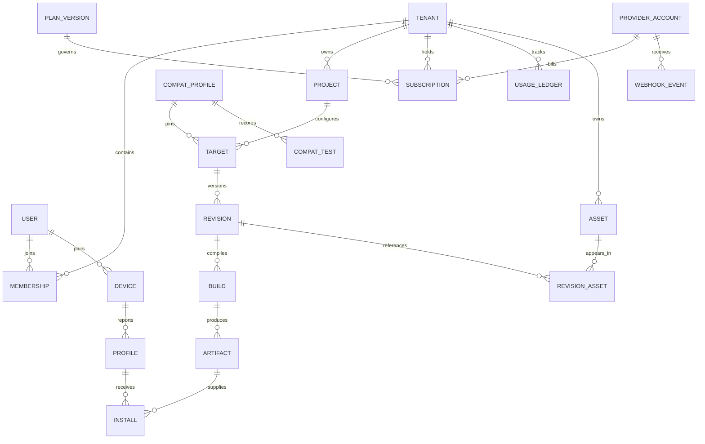

# ModFoundry architecture

Status: proposed, pre-implementation. Start with one version-specific Java workflow and a Windows installer. Commercial release requires the gates in ROADMAP.md.

## Service boundaries

| Component | Responsibility |
|---|---|
| Next.js / React / Tailwind | Public CMS pages, pricing, account, studio, version wizard and protected admin UI. Route through same HTTPS origin as API. |
| NestJS | Auth, tenancy, catalog, projects, entitlements, artifact authorization, device pairing, installs, public content and admin. |
| PostgreSQL | Authoritative state, tenant-scoped records, quotas, billing inbox, transactions and outbox. |
| Redis / BullMQ | Work delivery, cache and rate limits. Rebuild pending deliveries from PostgreSQL. |
| Background service | Outbox delivery, billing reconciliation, SMTP, retention, schedules and catalog sync. |
| Build supervisor | Leases jobs; copies bounded inputs to disposable runners and validates bounded outputs. |
| Disposable runner | Deterministic adapter, preloaded toolchain, no app credentials, no network by default. |
| Storage | Private filesystem backend first; optional S3-compatible backend behind same API/authorization. |
| Tauri / Rust | Windows profile inventory, local approval, transactional install/rollback and status. |

Project editor stores a validated, versioned document and content-addressed asset revisions. Autosave uses compare-and-swap revisions and local undo/redo. Keep immutable snapshots for builds and restoration. Client frameworks (Blockly, Canvas, Three.js) edit the model without becoming the persisted source of truth. Team editing starts with optimistic conflict detection. Extensibility uses explicit interfaces for generator, profile detection, artifact routing, billing, storage and future opt-in AI. Core workflows never call an AI endpoint.

## Proposed directory structure

| Path | Contents |
|---|---|
| apps/web | Public site, studio, account, admin |
| apps/api | Nest API, tenant authorization, webhook ingress, OpenAPI |
| apps/jobs | Billing, mail, retention, catalog import and outbox |
| apps/build-supervisor | Runner orchestration and artifact ingestion |
| apps/connect | Tauri desktop UI and Rust installation core |
| packages/contracts | API schema, studio document and shared diagnostics |
| packages/compatibility | Version registry and capability validation |
| packages/generators | Fabric, Forge, NeoForge and Bedrock adapter modules |
| packages/payments | Provider adapters and normalized billing contracts |
| infra | Compose, Dockerfiles, reverse proxies, toolchain images |
| scripts | Install, update, backup and restore |
| tests | Integration, compatibility fixtures and release acceptance |

## Core database ERD

Complementary tables: sessions, MFA and recovery codes, billing prices/payments/refunds, entitlement grants, credit reservations, device pairing requests, deployment jobs, install receipts, outbox, notification preferences, pages, branding, support tickets, audit events and backup evidence. Community, marketplace and server connections get separate domains when implemented. Tenant-owned joins use composite foreign keys including tenant ID. Device ownership is user-scoped with explicit workspace access at install authorization time. Compatibility and plans are versioned globally and historical references remain interpretable. Published artifacts use separate release records and explicit public access.

## Visual design concepts

| Concept | Palette and type | Studio layout and interaction |
|---|---|---|
| A. Foundry Bench | Charcoal and copper, Barlow headings, Inter controls | Three resizable panes: assets, live preview and inspector. Build and Install remain visible in a compact action bar. |
| B. Blueprint Workshop | Deep navy and cyan, IBM Plex Mono for metadata, Rethink Sans UI | Canvas and structured editor dominate. Persistent compatibility rail shows target details and clickable validation results. |
| C. Creator Desk | Warm ivory and violet, Bricolage Grotesque headings, DM Sans UI | Guided cards for beginners, collapsible inspector, larger previews and a collapsible activity drawer. |

All concepts include dark/light palettes, responsive navigation, touch-friendly controls and keyboard access. Check contrast and focus states after administrator branding changes. No Minecraft artwork, logos or imitation UI. Foundry Bench (A) is the approved permanent theme. Use charcoal surfaces, copper accents, and resizable asset, preview, and inspector panels for the desktop studio. Preserve dark and light modes, configurable branding, and responsive panel navigation.
